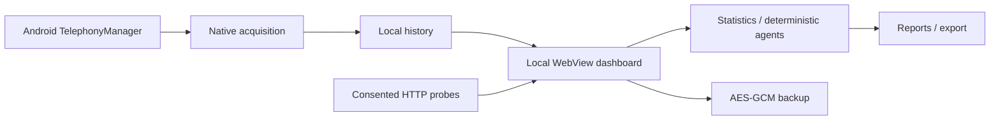

# NIKO RF Metrology PRO V4

**Android-native radio measurements and a local-first web metrology dashboard.**

Un atelier de diagnostic radio et réseau associant acquisition Android native, analyse statistique et tableau de bord web local.

    

**STUDIO NIKO DESIGN** · Build smart. Stay lightweight. Create without limits.

[Signaler un problème / Report an issue](https://github.com/Nikoju1977/RF-Metrology-Pro/issues)

> [Insérer ici un GIF de démonstration / Insert demo GIF here]

[English overview](#english-overview) · [Documentation technique](#documentation-technique-fr) · [Roadmap](#roadmap--contribution)

## Pourquoi ce projet ?

Séparer les mesures réellement accessibles au modem Android de celles disponibles dans le navigateur. Les agents déterministes interprètent des relevés explicites plutôt que d'inventer des données radio ; le tableau de bord facilite les comparaisons et les exports.

## Architecture & sécurité

The web code uses local storage and Web Crypto for encrypted exports; local storage itself is not encrypted by default. The audit log is editable and is not a tamper-proof audit trail. ISO 9001-style traceability and measurement repeatability are engineering goals, not certification. No claim of ISO 13485, IEC 62304 or FDA 21 CFR Part 11 compliance.

**État de validation :** inspection documentaire et du code source lors de cette mise à jour ; pas de nouvelle exécution de l'application, de mesure de performance ni de test matériel.

## Documentation technique (FR)

Projet Android unique, Java 17, SDK 35, minSdk 30 (Android 11). Studio Niko. Pas d'APK compilé dans cette livraison.

## Architecture
- MainActivity : acquisition native des cellules LTE/NR par TelephonyManager, mesures fraîches, canaux, bandes et identifiants accessibles, sessions de trois relevés, historique, agents déterministes.
- DashboardActivity : instruments de métrologie V3 intégrés dans une WebView locale à origine HTTPS synthétique, sans hébergement nécessaire. Import automatique des relevés enregistrés depuis le module natif, sans identifiant complet de cellule ni GPS. Export par le sélecteur de documents Android et impression via PrintManager.
- Le test réseau contacte speed.cloudflare.com uniquement sur action et après consentement. La disponibilité, les CORS et les performances dépendent du réseau et de WebView. L'IA générative facultative dans l'écran natif nécessite un serveur compatible sur localhost:8080 ; elle n'est pas embarquée.
- Restrictions WebView : navigation externe bloquée, accès file:// désactivé, pas de contenu mixte ni de certificat TLS ignoré. Interface JavaScript limitée aux exports et à l'impression ; seuls les fichiers HTML empaquetés sont exécutés. Audit PHP/SQL heuristique local, sans exploitation de sites. Pas d'antivirus global, de VPN filtrant, de détection ISAC réelle ou de verrouillage de bandes.
- Stockage local privé à l'application (non chiffré par elle par défaut), sauvegardes exportables chiffrées AES-GCM. Les données importées dans le tableau de bord constituent une copie : effacer les deux historiques si nécessaire.

## Compilation
1. Ouvrir ce dossier dans Android Studio (JDK 17, SDK Android 35, AGP 8.7.3, Gradle 8.9).
2. Synchroniser Gradle. Build > Build APK(s), ou `gradle :app:assembleDebug` avec Gradle 8.9.
3. L'APK de développement signé automatiquement se trouve dans `app/build/outputs/apk/debug/app-debug.apk`. Vérifier le code et les résultats avant installation. Transférer sur le téléphone et ouvrir l'APK, puis révoquer l'autorisation d'installation de sources inconnues après installation.
4. Alternative : ouvrir l’onglet Actions du dépôt et exécuter le workflow Android fourni ; l'APK de développement apparaît dans les artefacts si la compilation réussit.

## Utilisation
Autoriser la localisation précise pour lire les cellules (Android l'exige), puis actualiser. Choisir un emplacement et enregistrer des mesures. Ouvrir « Métrologie réseau · sécurité · rapports » pour comparer les relevés et lancer une campagne HTTP. Utiliser le retour Android pour retrouver l'écran natif. Les mesures RF ne sont pas garanties étalonnées ; la latence HTTP n'est pas un ping ICMP.

## Vérifications effectuées dans cet environnement
- 9 assertions JVM AgentEngine/RadioMath réussies.
- 12 assertions du moteur statistique et audit local V3 réussies (moteur inchangé).
- Syntaxe des scripts JavaScript du tableau de bord V4 validée.
- Compilation Android, signature APK, comportement WebView, accès modem, export et test physique Samsung : non vérifiés. SDK Android/Gradle absents et réseau de téléchargement indisponible dans l'environnement de travail.

## Dépôt unifié Android + Web
- `app/` : application Android V4.
- `web/` : PWA V3 complète, API de test HTTP pour Vercel et édition HTML autonome.
- Vercel : choisir `web` comme Root Directory et le framework Other ; ne pas y compiler Android.
- GitHub Actions : après un push sur `main`, le workflow lance les tests et compile l'APK debug. Consulter Actions > dernier run > Artifacts > NIKO-Metrology-APK (archive ZIP). Un tag `v4.0.0` déclenche aussi la publication d'une préversion GitHub Releases avec APK directement téléchargeable, sous réserve de réussite et des permissions GitHub. Aucun tag ni release n'est créé par cette archive.
- Le certificat debug peut changer entre runners : ne pas compter sur les mises à jour sans désinstallation. Une signature de distribution persistante doit être configurée séparément avec une clé privée protégée, jamais committée.
- Avant publication publique : vérifier les licences de toutes les dépendances, les fichiers et les paramètres de confidentialité.

## Roadmap & contribution

Prochaines étapes proposées, non présentées comme terminées :

- [ ] Verify Android build and APK signing in CI.
- [ ] Validate modem access and WebView exports on physical LTE/NR devices.
- [ ] Compare HTTP measurements with reference instruments; document uncertainty.
- [ ] Test encrypted backup restoration and data deletion.

Les retours d'utilisation, rapports de bugs et propositions d'amélioration sont les bienvenus via les [issues](https://github.com/Nikoju1977/RF-Metrology-Pro/issues). Pour une première contribution, rechercher ou proposer une issue portant le label `good first issue` ; ce label n'est pas garanti déjà créé. Les modifications de code doivent respecter la notice de droits existante et, si nécessaire, obtenir l'autorisation du titulaire. Ne jamais publier de clé API, données personnelles ou fichiers sensibles.

## English overview

Android V4 uses Java 17, compile SDK 35 and minimum SDK 30. Its web dashboard combines HTTP network probes, statistical summaries, deterministic diagnostic agents, imported radio data and encrypted backup exports. The browser cannot directly access modem measurements; the native layer requests Android permissions. This is not calibrated RF test equipment, an antivirus, or a real ISAC detector. The optional generative AI integration requires a compatible local server; it is not bundled.

### Quickstart

For Android, open the repository in Android Studio with JDK 17 and SDK 35; build the debug APK as described below. The web edition is under `web/`; use a local web server for the UI and a compatible endpoint for HTTP tests. The root HTML also contains the standalone dashboard. Do not assume a compiled APK exists until a successful build is verified.

### Contribution

Document a device-specific permission or measurement limitation without publishing sensitive location or cell identifiers (`good first issue`, suggested label). Feedback is welcome; code contributions and redistribution remain subject to the existing rights notice. No new runtime tests or benchmarks were performed during this documentation update.

## Licence & auteur / License & author

**© 2026 Studio Niko Design — [Nikoju1977](https://github.com/Nikoju1977).** Original contributions are subject to the existing [copyright notice](LICENSE.md), all rights reserved; public source access does not constitute an open-source license. Third-party components retain their own licenses. No license changes are made by this README.
